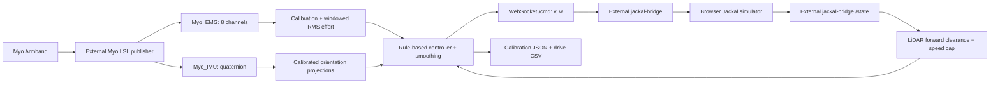
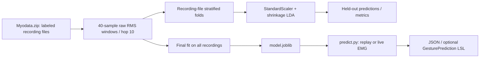

# Architecture

## Runtime control path

The controller connects to `ws://localhost:8765/state` and `/cmd`. Commands include `type`, linear `v`, angular `w`, source, sequence, and timestamp. The state supplies scan geometry, pose, status, collisions, and course progress. The bundled site is served separately from Python control logic. The steering overlay reads simulator hooks and applied angular command; it is visual feedback, not a controller.

For 3.2, 40 EMG samples and 10 IMU samples are buffered (nominally 200 ms at 200/50 Hz). Per-channel mean is removed before RMS; mean channel RMS provides effort. Quaternion `[qw,qx,qy,qz]` is converted into an averaged normalized up-vector. Calibration defines neutral orientation, left/right projection axis, orthogonalized lift axis, and relaxed/fist effort references. This is calibrated signal processing and rule-based control, not training the offline LDA model.

## Separate machine-learning path

There is no implemented connection from `GesturePrediction` to the documented robot controllers. The classifier emits class/confidence/valid, not `(v,w)`. Its raw RMS features differ from the controller's mean-centered RMS. Any future integration requires an explicit mapping, neutral/rest handling, freshness checks, and system-level validation.
